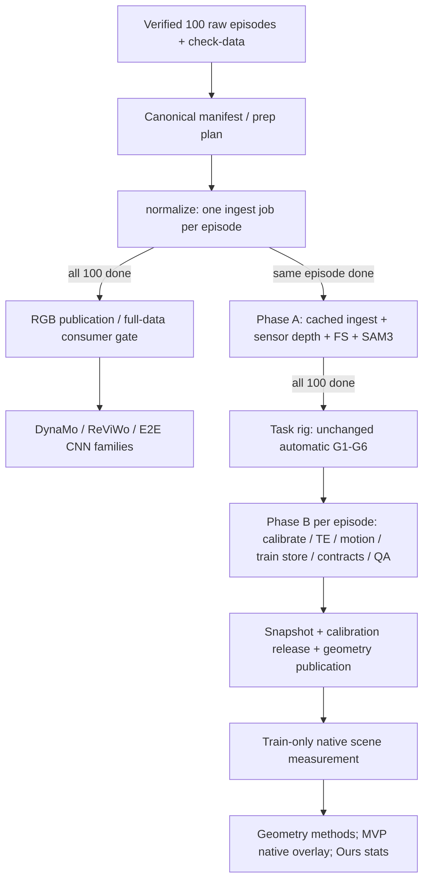

# BH1 dependency evidence (d7a1148 scientific pipeline; BH adapter changes identities and barriers only)

CONFIRMED: 100 success episodes, S only; the existing paired-manifest algorithm supplies the seed-0 90/10 split;
pretraining and FQL retain all full-data gates and seeds 0/1/2. No training on a partial collection.

## Actual method inputs

All rows need their publication's exact manifest/raw identities, split, outcomes and consumer gate. The table distinguishes
directly consumed data from dependencies imposed by the shared geometry publication and calibration protocol.

| Method | Actual pretraining input / targets | FQL observation | Earliest unchanged release |
|---|---|---|---|
| Ours orig and ch01 | normalized RGB; FoundationStereo metric depth; accepted rig K/w2c; TrackEverything moving 3D tracks and FK gripper points; motion scores; train-only workspace anchor statistics | one camera's 3-frame RGB history + 10D proprio, frozen export; inherits geometry gate | geometry publication + workspace stats |
| ReViWo | normalized RGB in synchronized M5 multiview sets; robot surface motion selects sets; no extrinsics/depth/masks | one camera RGB + proprio, frozen export | full normalized collection + RGB publication |
| DynaMo | each camera's own RGB timeline/windows | one camera RGB + proprio, frozen export | full normalized collection + RGB publication |
| SinCro | synchronized RGB windows, episode K and calibrated OpenGL c2w for ray rendering targets; no direct depth or SAM labels in loader | one camera RGB history + proprio; export inherits geometry gate | geometry publication |
| SNeRL | synchronized RGB + normalized calibrated camera poses; RGB/SAM semantic/ONLINE DINO rendering targets; FS depth used for validation depth MAE | three synchronized RGB views + calibrated poses + proprio | geometry publication + train-only lookat/pose_scale |
| 3D-MVP multiview | normalized RGB, **native RealSense sensor depth overlay**, K/c2w; fused point cloud and measured scene bounds | three RGB-D views + K/c2w + proprio | geometry publication + native overlay + bounds |
| 3D-MVP single | shares the multiview pretrained encoder; no independent pretraining row | one RGB-D view + K/c2w + proprio | same native overlay + shared encoder |
| E2E CNN / noaug | no encoder-pretraining or export row; RGB history jointly encoded during FQL | one RGB view + proprio, recorded commands; original augmentation/noaug settings | full normalized collection + RGB publication |

Evidence (repo paths, line numbers):

- Classification and inherited FQL gate: `s4d/rwlearn/gate.py:122`, `:170`, `:194`.
- Direct baseline loaders: `s4d/rwlearn/baseline_data.py:121` (sync, K, optional extrinsics), `:180` (SinCro),
  `:213` (ReViWo, geometry=False), `:233` (DynaMo), `:271` (MVP RGB/depth/K/c2w), `:297` and `:339` (SNeRL).
- SNeRL targets and loss: `s4d/baselines/snerl/model.py:130`, `:175`; validation FS depth:
  `scripts/train_snerl.py:68`, `:78`. No cached DINO prep dependency.
- Ours direct sample fields: `s4d/realworld/train_windows.py:246`, `:254`, `:257`, `:265`;
  FS-only store enforcement `s4d/rwlearn/ours.py:227`.
- Exact downstream inputs: `s4d/rwlearn/observation.py:35`; frozen feature extraction:
  `s4d/rwlearn/fql_data.py:85`; native depth restricted to MVP: `:127`.
- Native overlay reads SHA-verified raw RGB/depth, applies accepted rig correction, preserves timestamps:
  `s4d/rwlearn/native_depth.py:151`, `:166`, `:189`; no FS substitution for MVP.

## Every row kind in the pnp-v2 waves

The original graph has 90 rows: RGB 33; geometry 57. `ops/jobs/pnpv2_plan.py:52`, `:93`, `:105`, `:115`, `:154`,
`:185`, `:199`, `:206` contain their actual argv and dependencies. BH status uses this graph for information only;
BH1 deliberately exposes no registration command or training configuration generation.

| Row kind | Actual inputs / dependency |
|---|---|
| gate (RGB/geometry) | five publication documents + the referenced compact store; full membership and per-consumer readiness, `s4d/rwlearn/pnpv2_publication.py:43` |
| stats (Ours) | geometry compact store, **train split only**, max-stride windows; FS depth + calibrated cameras + motion scores, `scripts/compute_workspace_stats.py:24`, `:84` |
| native (MVP) | geometry compact store, raw H5 depth, accepted task rig/reference; verified overlay as above |
| pre | method-specific table above; Ours additionally stats; MVP additionally native overlay; SNeRL measured scene normalization |
| export | Ours checkpoint at 400k; baselines encoder.pt; immutable artifact copies, `ops/jobs/pnpv2_plan.py:126`, `:150` |
| fqldata | exact view/store, outcomes, consumer gate, raw actions/engagement/sent/segment fields, encoder export except pixel CNN; MVP uses native overlay; `s4d/rwlearn/fql_data.py:119`, `:159` |
| fql | built dataset, split and gate; pixel CNN also RGB store; existing seeds/settings, `ops/jobs/pnpv2_plan.py:185` |
| eval | policy.pt -> artifact JSON (this row does not run a robot), `ops/jobs/pnpv2_plan.py:199` |
| taskeval (Ours orig/ch01) | 400k checkpoint, geometry store, split/gate/stats; waits for its three FQL seeds; `ops/jobs/pnpv2_plan.py:206` |

## Implemented DAG split and remaining barriers

CONFIRMED: `s4d/realworld/pipeline.py:82` fingerprints ingest solely from the adapter/source identity, writes normalized
frames/meta and then caches the complete record. Stage scheduling is outside the fingerprint. The BH normalize and
Phase-A jobs use byte-identical copied pipeline YAML. Phase A reruns the original argv; ingest reuses the validated
completion record. No scientific stage setting changes.

CONFIRMED: `s4d/realworld/rgb_train_store.py:70` reads normalized data alone when rgb_only=True and semantic=False;
`:78` empties later-stage dependencies; `:84` never reads calibration. The existing
`tests/test_drawer_rgb_inputs.py:90` checks exact consumed array equality and DynaMo/ReViWo tensor equality with later
stages absent. New split tests bind the SAME YAML hash in both branches. Container/HDF5 timestamps and operational
provenance can differ between independent runs; scientific arrays and selection rules stay byte-identical.

CONFIRMED: the dispatcher supports per-episode `external_states`, `ops/jobs/rwprep_remote.py:442`;
`ball_hiding.split_jobs` uses one corresponding normalize job, avoiding an all-episode Phase-A barrier.

CONFIRMED: further calibration streaming is blocked by the existing shared `view` job, which waits for all Phase A
and checks normalized/sensor/FS/SAM completion (`scripts/realworld_dsreset_calibration.py:52`, `:113`). Solves and G1-G6
use the full frozen collection. Phase B also requires the accepted whole-task rig. Geometry publication checks all
Phase-A/B states and the complete calibration-bound compact closure (`ops/jobs/pnpv2_geometry.py:72`, `:171`).
These barriers remain. Per-episode RGB export caching would require changing immutable publisher retry/provenance
logic; this patch retains the existing all-100 publisher and changes only its upstream normalization barrier.

HYPOTHESIS: later per-episode RGB exports could reduce the last export pass; no measured benefit or byte-identical
retry implementation is claimed here. No gate or partial-data training exception was introduced.
