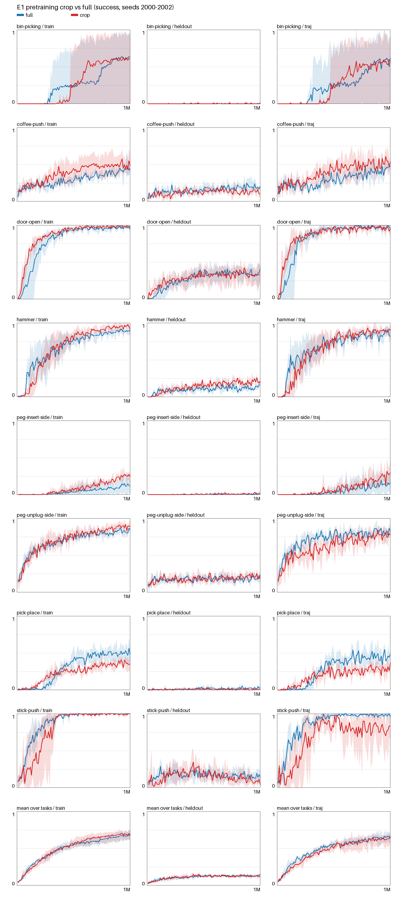
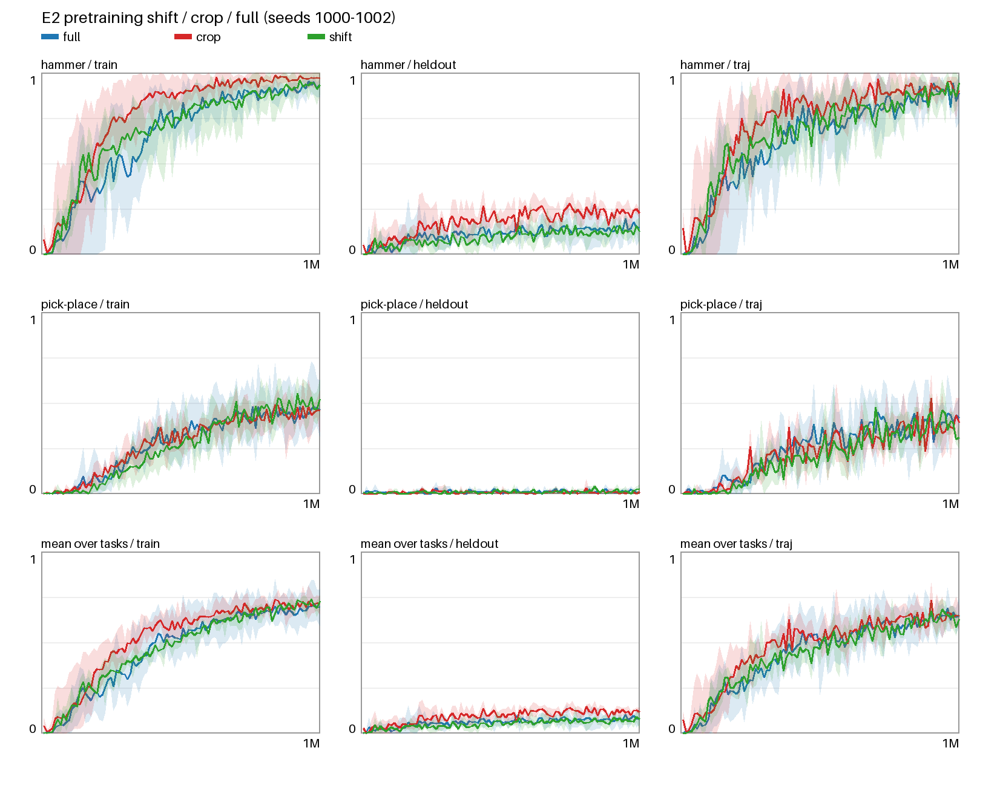
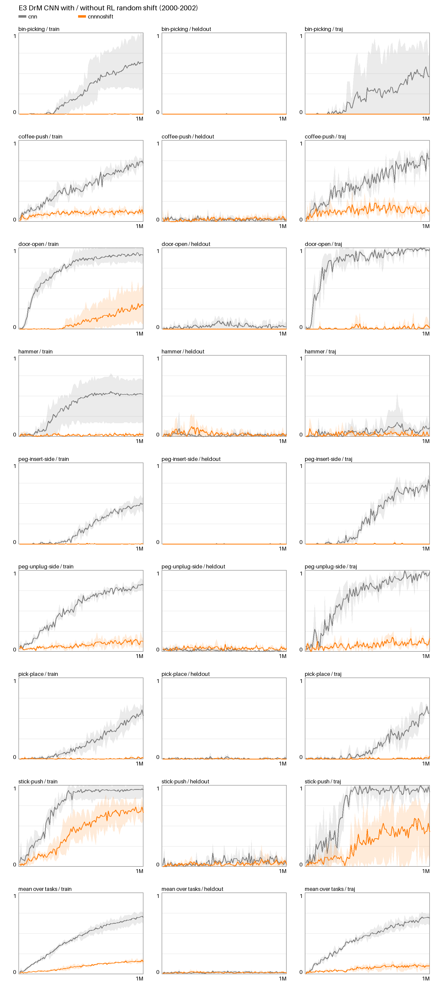

# Follow-up experiments E1–E3: consolidated report

2026-10-19. Attribution only: the frozen method (C + D0 + M3D, 200k pretraining steps, pretraining seed 0) does not change.
Registration: `runs/setup/followup-registration-20261017.json`, with its analysis plan. Implementation details were logged in
docs/EXPERIMENT_LOG.md (10-18 22:20) before any comparison was computed. Report JSON:
`runs/setup/followup-report-20261019-201913.json`. Full tables: `docs/FOLLOWUP_TABLES.md`. Learning curves:
`docs/figures/followup/e{1,2,3}_success_curves.png`.

All RL runs use DrM for 1M agent steps, with 240 evaluation episodes every 10k steps. Training cameras, held-out cameras
and moving-camera trajectories are reported separately.

Reading guide:
- The historical Stage 2 rule (seed-mean last-5 success, margin max(0.10, 2 × SE)) is shown as context in every table. A
  difference within the margin is **not** evidence of no effect.
- Confidence intervals are paired-by-seed bootstrap intervals (10,000 resamples). With three seeds they are coarse;
  see Uncertainties.

## Findings

1. **E1, pretraining crop on all eight tasks (seeds 2000–2002).** Crop leaves RL success essentially unchanged on
   average. Mean over tasks of crop − full, last-5 success [task-stratified 95% CI]:
   - training cameras +0.017 [−0.072, +0.107];
   - held-out cameras −0.011 [−0.034, +0.013];
   - trajectories −0.025 [−0.111, +0.062].

   The AUC differences are also centred on zero, with CIs spanning it. Crop is **not faster**: time to 0.5 training
   success changes by −9k steps [−80k, +67k]. Early trajectory AUC (10k–300k) is slightly lower, −0.037 [−0.074, −0.001].
   The typical (IQM) held-out success is lower with crop: 0.102 [0.094, 0.112] vs 0.126 [0.111, 0.140].

   Per task the effects have opposite signs:
   - pick-place is the only task worse under the historical rule (trajectory −0.14);
   - stick-push trajectory drops by −0.20 [−0.43, −0.05] and stays within its 0.23 margin, but it is a large drop;
   - peg-insert-side training improves by +0.13 [+0.05, +0.28] and stays within its 0.14 margin.

   Representation (crop vs full encoder, full-split evaluation at 200k) is mixed. On the two development tasks, crop is
   only worse: hammer 6 of 32 metrics and pick-place 3. The non-development tasks show both directions, against the
   development-task margins as a descriptive yardstick.

2. **E2, pretraining random shift (hammer and pick-place, seeds 1000–1002).** Replacing the resized crop with DrM-style
   shift does not improve RL. Shift vs full is within margin for every camera condition on both tasks: hammer training
   −0.00, held-out −0.02, trajectory +0.03; pick-place +0.03, +0.00, −0.07. Shift reaches 0.5 training success sooner:
   hammer 213k → 153k; pick-place 807k → 713k, where all 3 shift seeds reach 0.5 vs 1 of 3 for full. Final and last-5
   success do not improve.

   Shift **loses crop's held-out gain on hammer**: shift vs crop is −0.10 [−0.13, −0.08], worse under the historical
   rule. It also degrades the representation, mainly rendering and moving-camera retrieval: pick-place 9 worse / 0 better
   of 32 metrics vs full (PSNR −0.8 dB, moving-camera PSNR −1.7 dB, trajectory retrieval −0.10); hammer 3 worse / 1
   better.

3. **E3, DrM CNN without RL random shift (all eight tasks, seeds 2000–2002).** Disabling RandomShiftsAug makes
   end-to-end CNN learning collapse:
   - training-camera last-5 success drops by −0.543 [−0.606, −0.480];
   - IQM training success falls from 0.718 to 0.060;
   - all eight tasks are worse under the historical rule;
   - time to 0.5 is +373k steps [+313k, +430k];
   - training return drops by −1,059 (last-5).

   **Separating the training-camera change from the novel-view change:**
   - Trajectory success falls in step with training success: the pooled difference-in-differences Δ(trajectory) −
     Δ(training) is −0.052 [−0.138, +0.028] at last-5 and −0.024 [−0.071, +0.018] for AUC.
   - Held-out-camera success is at the floor in **both** arms (IQM 0.008 vs 0.009). The held-out difference-in-differences
     of +0.547 [+0.485, +0.609] is therefore mechanical: held-out success cannot fall further.

   Conclusion: the effect is a **general learning degradation**. There is no evidence of an additional, viewpoint-specific
   robustness loss. Because the standard CNN is already at zero on held-out cameras, the experiment cannot detect such a
   loss on those cameras.

## Protocol and fairness

- **Seeds and controls, matched within each comparison:**
  - E1 crop vs the full method's final runs (`s3-drm-splatter4d-*`, seeds 2000–2002); hammer and pick-place crop RL at
    these seeds was added in this registration.
  - E2 shift vs `s2rl-full-*` and `s2rl-crop-*` (seeds 1000–1002).
  - E3 vs the completed CNN baseline (`s4-drm-cnn-*`, seeds 2000–2002).
  - Six missing full-split evaluations of the full method's non-development encoders were run as controls.
- **Config differences from the controls:** E1 and E2 differ only in `vision.export_path` (24 and 18 runs); E3 only in
  `agent.random_shift` (24 runs). Every evaluation point has 240 episodes.
- **Hosts:** placement is host-neutral and recorded per run (E1: 35 remote / 13 local run records; E2: 12 / 24;
  E3: 47 / 1).
- **Source and review:** the `aug.shift` / `agent.random_shift` source passed the full native suite and the remote
  release check (7c0d0d2). Codex reviewed the augmentation changes and configs and found no code issues; three
  analysis-plan points were adopted before registration.
- **Operational events (no run affected):**
  - host-neutral placement overlays;
  - brief remote SSH outages, all reconciled with no job lost or relaunched;
  - the local GPU allowlist change on 10-19 (GPU 6 revoked; no campaign job was on it);
  - a disk cleanup that deleted replay buffers and intermediate policy snapshots after their evaluations were recorded.
    Final policies, final full checkpoints, evaluation histories and encoder exports are all kept.

## E1: crop vs full, per task (seeds 2000–2002)

Control is the full method, arm is crop. **worse** / **better** marks the historical rule on last-5 success.

| task | training last-5, control → arm | Δ training last-5 [paired CI] | Δ held-out last-5 | Δ trajectory last-5 | Δ training AUC | Δ early AUC (10k–300k) | time to 0.5 (reach) |
|---|---|---|---|---|---|---|---|
| bin-picking | 0.62 → 0.61 | -0.01 [-0.96, +0.92] | +0.00 [+0.00, +0.01] | -0.02 [-0.88, +0.86] | +0.01 [-0.23, +0.48] | -0.01 | 690k → 697k (2/3 → 2/3) |
| coffee-push | 0.44 → 0.48 | +0.04 [+0.02, +0.06] | -0.06 [-0.07, -0.05] | +0.08 [+0.03, +0.15] | +0.09 [-0.01, +0.19] | +0.03 | 970k → 567k (1/3 → 2/3) |
| door-open | 0.97 → 0.98 | +0.01 [-0.00, +0.04] | -0.03 [-0.06, +0.02] | -0.02 [-0.06, +0.03] | +0.06 [-0.01, +0.10] | +0.17 | 143k → 90k (3/3 → 3/3) |
| hammer | 0.89 → 0.95 | +0.06 [+0.03, +0.11] | +0.06 [+0.06, +0.07] | +0.03 [-0.02, +0.09] | +0.01 [-0.14, +0.10] | -0.09 | 177k → 187k (3/3 → 3/3) |
| peg-insert-side | 0.12 → 0.25 | +0.13 [+0.05, +0.28] | +0.01 [+0.01, +0.02] | +0.12 [+0.04, +0.23] | +0.05 [-0.02, +0.12] | +0.00 | 1000k → 1000k (0/3 → 0/3) |
| peg-unplug-side | 0.82 → 0.89 | +0.06 [-0.02, +0.14] | +0.02 [-0.03, +0.06] | -0.05 [-0.13, +0.03] | +0.02 [-0.02, +0.08] | -0.02 | 100k → 107k (3/3 → 3/3) |
| pick-place | 0.51 → 0.36 | -0.15 [-0.29, +0.05] | -0.02 [-0.03, -0.01] | -0.14 [-0.17, -0.09] **worse** | -0.07 [-0.11, +0.00] | +0.05 | 617k → 917k (3/3 → 1/3) |
| stick-push | 1.00 → 0.99 | -0.01 [-0.02, +0.00] | -0.08 [-0.10, -0.03] | -0.20 [-0.43, -0.05] | -0.07 [-0.13, +0.02] | -0.21 | 87k → 150k (3/3 → 3/3) |

## E2: shift vs full vs crop (development tasks, seeds 1000–1002)

The crop-vs-full rows are the existing development-seed comparison, repeated here for the three-way view.

| task, comparison | training last-5, control → arm | Δ training last-5 [paired CI] | Δ held-out last-5 | Δ trajectory last-5 | Δ training AUC | Δ early AUC (10k–300k) | time to 0.5 (reach) |
|---|---|---|---|---|---|---|---|
| hammer, shift vs full | 0.93 → 0.93 | -0.00 [-0.03, +0.04] | -0.02 [-0.11, +0.09] | +0.03 [-0.03, +0.11] | +0.03 [-0.04, +0.17] | +0.08 | 213k → 153k (3/3 → 3/3) |
| hammer, shift vs crop | 0.97 → 0.93 | -0.04 [-0.12, +0.07] | -0.10 [-0.13, -0.08] **worse** | -0.01 [-0.07, +0.11] | -0.08 [-0.16, +0.04] | -0.04 | 160k → 153k (3/3 → 3/3) |
| hammer, crop vs full | 0.93 → 0.97 | +0.04 [-0.04, +0.10] | +0.08 [-0.01, +0.17] | +0.03 [+0.01, +0.07] | +0.11 [+0.09, +0.13] | +0.12 | 213k → 160k (3/3 → 3/3) |
| pick-place, shift vs full | 0.46 → 0.49 | +0.03 [-0.21, +0.24] | +0.00 [+0.00, +0.01] | -0.07 [-0.19, +0.04] | -0.02 [-0.13, +0.15] | -0.02 | 807k → 713k (1/3 → 3/3) |
| pick-place, shift vs crop | 0.46 → 0.49 | +0.04 [-0.08, +0.22] | +0.01 [-0.01, +0.02] | -0.04 [-0.11, +0.07] | -0.02 [-0.09, +0.11] | -0.03 | 793k → 713k (2/3 → 3/3) |
| pick-place, crop vs full | 0.46 → 0.46 | -0.01 [-0.14, +0.09] | -0.01 [-0.02, +0.01] | -0.04 [-0.09, +0.00] | +0.00 [-0.06, +0.03] | +0.01 | 807k → 793k (1/3 → 2/3) |

## E3: CNN without RL shift vs CNN (seeds 2000–2002)

| task | training last-5, control → arm | Δ training last-5 [paired CI] | Δ held-out last-5 | Δ trajectory last-5 | Δ training AUC | Δ early AUC (10k–300k) | time to 0.5 (reach) |
|---|---|---|---|---|---|---|---|
| bin-picking | 0.63 → 0.00 | -0.63 [-0.98, -0.31] **worse** | +0.00 [+0.00, +0.00] | -0.51 [-0.83, +0.00] | -0.28 [-0.43, -0.19] | -0.01 | 797k → 1000k (2/3 → 0/3) |
| coffee-push | 0.72 → 0.12 | -0.60 [-0.64, -0.53] **worse** | +0.01 [-0.02, +0.04] | -0.61 [-0.73, -0.53] **worse** | -0.32 [-0.36, -0.29] | -0.11 | 540k → 1000k (3/3 → 0/3) |
| door-open | 0.91 → 0.29 | -0.62 [-0.74, -0.41] **worse** | -0.03 [-0.08, +0.00] | -0.94 [-0.98, -0.88] **worse** | -0.63 [-0.72, -0.48] | -0.41 | 150k → 933k (3/3 → 1/3) |
| hammer | 0.52 → 0.02 | -0.50 [-0.69, -0.12] **worse** | +0.00 [-0.01, +0.02] | -0.08 [-0.16, -0.01] | -0.34 [-0.49, -0.10] | -0.07 | 590k → 1000k (2/3 → 0/3) |
| peg-insert-side | 0.49 → 0.00 | -0.48 [-0.57, -0.41] **worse** | +0.00 [+0.00, +0.00] | -0.71 [-0.80, -0.64] **worse** | -0.19 [-0.20, -0.18] | -0.00 | 947k → 1000k (2/3 → 0/3) |
| peg-unplug-side | 0.82 → 0.11 | -0.71 [-0.77, -0.63] **worse** | +0.04 [+0.02, +0.05] | -0.84 [-0.90, -0.78] **worse** | -0.45 [-0.48, -0.42] | -0.15 | 337k → 1000k (3/3 → 0/3) |
| pick-place | 0.55 → 0.02 | -0.54 [-0.62, -0.48] **worse** | -0.01 [-0.02, +0.00] | -0.57 [-0.58, -0.55] **worse** | -0.20 [-0.24, -0.14] | -0.01 | 900k → 1000k (3/3 → 0/3) |
| stick-push | 0.94 → 0.68 | -0.27 [-0.41, -0.08] **worse** | +0.01 [-0.03, +0.06] | -0.49 [-0.80, -0.23] **worse** | -0.32 [-0.46, -0.21] | -0.24 | 227k → 537k (3/3 → 3/3) |

## Remaining uncertainties

- **Three seeds per arm.** The paired bootstrap over three seeds has few distinct resamples, so the CIs are coarse and
  can collapse to zero width when the seeds agree. Hedges g is unstable, and NA when both arms are at a ceiling or floor.
  Bin-picking is bimodal (2 of 3 seeds solve it in both E1 arms), so its CIs span almost ±1.
- **Seed sensitivity of crop.** On the development tasks, crop vs full is +0.035 (hammer) and −0.008 (pick-place) at
  seeds 1000–1002, but +0.059 and −0.149 at seeds 2000–2002. The pick-place trajectory verdict in E1 should be read
  with that in mind.
- **One pretraining seed.** Crop and shift were each pretrained once (seed 0), so pretraining-seed variance is not
  captured.
- **E1 representation yardstick.** For the non-development tasks, deltas are judged against the development-task
  margins as a descriptive yardstick only; those tasks have no registered margins of their own.
- **E2 scope.** E2 covers only the two development tasks; whether shift behaves differently elsewhere is untested.
- **E3 floor effect.** The CNN's held-out success is at the floor, so viewpoint robustness to the held-out cameras
  cannot be separated from learning failure. The trajectory cameras are the informative novel-view signal, and they
  track training.
- **Hosts.** Arms span hosts under the host-neutral policy. Host equivalence was characterised earlier but not
  re-verified per cell.
- **Efficiency measure.** Learning efficiency is measured in environment steps at 10k-step resolution (time to 0.5 and
  0.8 is censored at 1M); wall-clock time is not compared.
