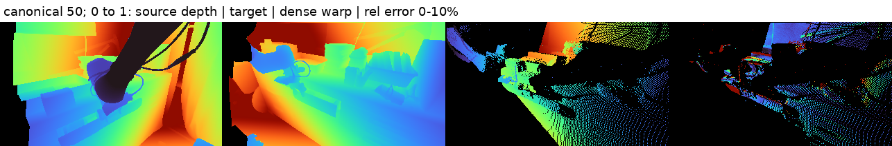
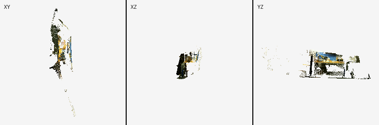
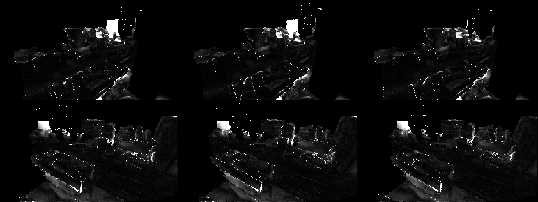

# Results

Final numbers only; each links to its run. Thresholds are never relaxed. Process notes: `docs/EXPERIMENT_LOG.md`.

## Meta-World campaign (2026-10-07 onward)

### Shutdown accounting / reporting verification (2026-10-15 20:40)

- Scheduler-only patch `7a14773`: **763 passed, 0 failed/errors/skips**,293.05s in the full native suite;
  all214 recorded source fingerprints matched the tested commit before integration/push. Evidence:
  `runs/setup/native-tests-intentional-stop-20261015.json` (original `runs/nv/i/runs/u/tests.json`). No model/config,
  scientific threshold or GPU selection changed. Intentional checkpoint/deadline exits do not consume restarts,
  including when exit observation precedes the stop proof. Ordinary remote resets still retain identity fingerprints;
  only a proved never-executed launch can release its corrected job-definition fingerprint.
- An initial suite invocation was **rejected by the runtime-output guard before collection**, because it requested an
  output outside its checkout's approved runtime root. It is not a test pass. The short checkout/output paths fixed
  the invocation; the first accounting-only candidate passed761, then the expanded candidate passed763 as above.
- Initial remote Stage2 admission was correctly refused before Docker because `config.yaml` was listed as a required
  numerical artifact. All40 placement definitions were amended to omit it; configs remain automatically synced and
  scientifically verified. All40 exact remote spec shapes then validated. Later ambiguous launch responses remain
  unknown until two direct absence checks, never treated as failures or blindly relaunched. Evidence:
  `runs/setup/reconcile-s2ab-nolambdadyn-seed0-hammer-20261015-203706.json` and
  `reconcile-s2ab-nocoverage-seed0-pick-place-20261015-203713.json`; subsequent attempts actually started.
- RL report `runs/setup/rl-report-20261015-203425.json` adds per-task seed-mean95% bootstrap intervals to **both
  success and return, last-5/final/AUC** (10,000 resamples,RNG0), for all96 final and30 original Stage2 runs, with
  camera sets separate. Point estimates and aggregate success IQMs match the20:00 report; returns are never pooled
  into a raw cross-task IQM. SHA-256 `dcdbd66f4e8640b13762333cff496479b0137322546f13e926b701f05b498d8c`.
- Permission layer **denied stopping/restarting scheduler PID2819571**. It was not stopped or bypassed; this remains
  an explicit final-shutdown blocker pending renewed permission. Scoped new driver processes use the tested reducer.

### Remote launch diagnostics verification (2026-10-15 20:54)

- Additional diagnostic-only candidate `c5a7571`: **764 passed,0 failed/errors/skips**,310.65s full native suite.
  All214 recorded source fingerprints independently matched the tested commit before integration/push.
  Evidence `runs/setup/native-tests-launch-diagnostics-20261015.json` (original `runs/nv/i/runs/v/tests.json`).
- Failed non-transport launcher responses now retain bounded, redacted stdout/stderr beside the immutable attempt
  spec. No automatic retry, failure-budget waiver, host repair, source/image change to training or scientific change.
- Third refused attempt `s2ab-misscaled-scale-seed0-pick-place` reconciled only after646s and two direct absence checks
  with positive control, then actually started as attempt2. Proof `runs/setup/reconcile-s2ab-misscaled-scale-seed0-pick-place-20261015-204300.json`.
  All eight remote containers showed finite fresh training metrics at20:52; exact inventory/ETA caveats in
  `runs/setup/servers-filled-20261015.json`. Earlier non-config refusal causes remain unestablished, not assigned to
  NVML or foreign activity. A brief SSH interruption recovered without outage-driven relaunch.

### Final pretraining length: 200k selected (2026-10-13 13:52)

Registered C + D0 + M3D A200/A300 rule applied unchanged after all 8 full-split evaluations and all 16 proxy
trainer/evaluator closeouts completed. One pretraining seed 0 per arm/task; compared representation runs local,
all RL arms on the same remote host. Independently rechecked endpoint/checkpoint hashes, full-split batch counts,
configuration equality except schedule length, final synced numerical provenance/checksums and every last-5 score.

- A300 wins **5/40** counted comparisons (hammer 3, pick-place 2), loses **1/40** (hammer trajectory hand-velocity
  R² at stride 2), with 34 ties. Wins: hammer training moving PSNR at strides 2/6 and relative EPE at stride 2;
  pick-place training and trajectory hand-velocity R² at stride 2.
- Hammer 400k-agent-step RL, seeds 1000-1005: A200 **0.696111**, A300 **0.770833**, difference **+0.074722**;
  SE(diff) **0.100895**, registered margin **max(0.10, 2 x SE) = 0.201791**. A300 is not better beyond the margin.
  Per-seed scores below are rounded; the decision uses full-precision synced values.

| Arm | s1000 | s1001 | s1002 | s1003 | s1004 | s1005 | Mean |
|---|---:|---:|---:|---:|---:|---:|---:|
| A200 | 0.898 | 0.610 | 0.540 | 0.837 | 0.368 | 0.923 | 0.696111 |
| A300 | 0.910 | 0.590 | 0.792 | 0.798 | 0.750 | 0.785 | 0.770833 |

The 200k condition holds (wins <= 8 and RL not better beyond the margin); the 400k condition fails. **Use exactly
200,000 pretraining steps, warmup 10k plus cosine to that endpoint, for every final task and ours ablation.**
Pick-place RL is context only: A200 0.016667 versus A300 0.003333 (two seeds, 200k agent steps); it is not counted.

Decision: `runs/setup/length-decision-20261013.txt`. Independent verification:
`runs/setup/length-verification-20261013.json` (SHA-256
`1cfd70b71e6c0604872e9221063255d3c74f6550a98bcbe1fcc64520e94bce18`). Speculative 300k work remains context only,
not final Stage 3. No thresholds, seeds or protocols were changed after seeing the results.

### Frozen Stage 3 registration and dispatch checks (2026-10-13)

`method-frozen-v1` is an annotated tag on accepted `226d8ae89b6f65097d372e597e0a7734d2eee3e0`, pushed to origin.
Its annotation embeds all eight frozen task configurations and the length-evidence identity. Local copy:
`runs/setup/method-frozen-v1.json` (SHA-256
`65176543d4db2499d9e755555ca16dc6d08de4d6cc8dac6608777be9675d1af9`). No unaccepted baseline code is included.

Registered six fresh 200k pretraining jobs, six guarded exports and 24 DrM trainers plus 24 companions (eight tasks,
RL seeds 2000-2002, 1M agent steps). Hammer/pick-place reuse their verified A200 exports. Each new pretraining
completion requires its synced final 200k checkpoint; exports require verified pretraining closeout and retain
encoder/config/checkpoint provenance before releasing RL dependencies. Speculative 300k schedules and evidence
are preserved, but no further speculative 300k admissions occur after the 200k decision.

The first generated candidate queue failed YAML parsing: appending after the entire document placed new sequence
entries after trailing top-level resource fields, not within `jobs`. **The authoritative queue was unchanged.**
The corrected insertion uses the parsed jobs-sequence boundary and asserts exact equality of every old job and host
field before atomic publication. Failed candidate retained as
`runs/setup/stage3-final-registered-20261013.yaml`; corrected candidate uses the `-v2.yaml` suffix.

Registration evidence: `runs/setup/stage3-final-registration-20261013.json`. Configuration and isolated dispatcher
fixture checks: **100 passed**, `runs/setup/stage3-dispatch-checks-20261013.json`. They cover exact frozen overrides,
seeds, verified data/export gates, 300k exclusion, GPU/RAM ceilings, independent trainer/evaluator admission and
later companion admission. They execute no native model substitution or new upstream code and are **not** a new
full-suite acceptance claim. Campaign jobs continue through `scripts/jobs.py` on the unchanged accepted release;
no GPU guard/selection change or rerun of isolation occurred.

A separate permission gate blocked copying the dispatcher while it retained automatic runtime-computed remote
replay deletion. That deletion path was removed, the non-deletion dispatcher checks reran (100 passed), and the
safe durable copy/start was permitted. Only the owned controller loop was restarted; trainers/evaluators were
not stopped. Subsequent completed replays are retained, with free disk recorded and admission floors enforced.

### Stage 2 attribution registration (2026-10-13)

Reporting margins were written before registration: `runs/setup/stage2-reporting-margins-20261013.json`
(SHA-256 `5fadd04fd5050a440f13d5adad540e424a0f78257ed3f82eacec36df31db5677`). They come from the fixed M3D
seed 0/1 full-split 100k references; all four summary hashes were checked against their completion proofs. They
are attribution reporting margins, not new method-selection gates.

Registered 108 local jobs: 10 variants x 2 development tasks (seed 0, 200k), 20 full-split evaluations, 8 guarded
exports, and 30 DrM trainers with 30 companions. RL is 1M agent steps, seeds 1000-1002, for the full method (reused
A200 encoders) and the T=1, no-motion, pure no-InfoNCE and single-group variants. Registration asserts that each
variant config differs from the frozen config only in its intended keys. Pure no-InfoNCE sets only
`loss.invariance=0`; the legacy joint `no_infonce.yaml` is not used. Evidence:
`runs/setup/stage2-registration-20261013.json`.

The first candidate queue failed YAML parsing: PyYAML wrote shared `deps` lists as `&id001` anchors, which collide
with an anchor already in the queue. **The authoritative queue was unchanged.** The failed candidate is retained as
`runs/setup/stage2-registered-20261013.yaml`. The published `-v2.yaml` candidate uses alias-free job copies and the
same old-job equality checks.

**Local over-admission (my driver defect, 15:21).** The first Stage 2 driver counted a new job's footprint only
for 10 minutes after launch. The seven pretrains admitted at 15:10 were still at ~3-4 GB PSS at 15:21, so a pass
then admitted an 8th pretrain plus five full-method RL reference jobs (three trainers, two evaluators). Under the
measured-footprint rule (base charge ~59 GB + 8 x 10.77 GB + 5.5 GB uncached data) the 8th pretrain alone breaks
the 150 GB hard cap; the previous 4-hour recording (settled 8.2-9.9 GB per trainer) projects ~151 GB. Peak observed
charge was 131.9 GB; the cap was not crossed. A pass started at 15:32 was cut off by stopping the driver loop and
launched nothing. Remediation:
- Under the standing checkpoint-pause authorization, the three RL trainers were paused right after publishing their
  50k checkpoint (`checkpoint_paused` events, hashes in `runs/<id>/checkpoint_pause.json`). Their evaluators pause
  after evaluating through 50k. The 8th pretrain (`s2ab-singlegroup-seed0-pick-place`) pauses at its 10k checkpoint,
  after the 10k validation is logged and before step 10,050. No logged step or evaluation is lost; all resume through
  `scripts/jobs.py`.
- The driver now reserves each running job's remaining growth (footprint minus current session PSS) instead of a
  10-minute ramp, and treats checkpoint-paused jobs as restartable. The first evaluator-pause attempt refused to signal:
  its identity check expected the evaluator job id in the command line, but local evaluators carry only
  `--train-job <trainer>`. That check was corrected and the trainers were not touched again.

**Stage 2 RL footprints switched to measured values (2026-10-14 11:58).** The driver reserved the declared 6 GiB for
every DrM trainer and evaluator, contrary to the measured-footprint admission rule. Measured splatter4d DrM peaks:
trainer RSS <= 2.65 GB at 1M agent steps (`runs/s3-drm-splatter4d-{hammer,pick-place}-s2000/final.json`) and local
session PSS 2.80 GB at 667k; evaluator session PSS 3.5-3.8 GB. The driver now reserves 3.5 GB per trainer and
4.5 GB per evaluator (~25% margin). The growth-aware accounting (footprint minus current PSS), the 140 GB admission
ceiling, the 150 GB hard cap and the 147 GB alert are unchanged.

**Stage 2 attribution, first complete comparisons (2026-10-15 04:57; attribution only).** Report
`runs/setup/stage2-report-20261015-045744.json`, from `runs/setup/tools/stage2_report.py`. Representation is
compared at 200k, seed 0, against the full method's own 200k evaluation, using the prospective margins; RL uses the
existing rule max(0.10, 2 x SE). Metrics beyond margin, worse/better:

| variant | hammer | pick-place |
|---|---|---|
| pure no-InfoNCE | 21/0 | 25/1 |
| no-motion | 15/0 | 23/0 |
| T=1 | 24/0 | 22/1 |
| single-group | 6/0 | evaluation pending |

- Pure no-InfoNCE loses retrieval and object position: trajectory retrieval 0.815 -> 0.414 on hammer.
- No-motion mainly loses motion: hammer relative EPE 0.248 -> 0.506.
- T=1 has undefined motion by construction (relative EPE 1.0) and loses velocity R².
- Single-group mostly loses utilisation and dynamic Chamfer.
- First complete RL comparison, no-motion vs full on hammer (seeds 1000-1002):
  - training cameras 0.967 vs 0.935 (+0.032, margin 0.100, within margin);
  - held-out cameras 0.132 vs 0.149 (within);
  - trajectories 0.980 vs 0.882 (+0.098, margin 0.100, within; borderline).
- Second complete RL comparison, pure no-InfoNCE vs full on hammer (05:08,
  `runs/setup/stage2-report-20261015-050839.json`), all three measures worse beyond margin:
  - training cameras 0.575 vs 0.935 (-0.360, margin 0.212);
  - held-out cameras 0.045 vs 0.149 (-0.104, margin 0.100);
  - trajectories 0.203 vs 0.882 (-0.678, margin 0.109).
- Third complete RL comparison, T=1 vs full on hammer (05:14,
  `runs/setup/stage2-report-20261015-051450.json`), all within margin:
  - training cameras 0.933 vs 0.935 (-0.002, margin 0.106);
  - held-out cameras 0.066 vs 0.149 (-0.083, margin 0.100);
  - trajectories 0.907 vs 0.882 (+0.025, margin 0.148).
- So on hammer, RL is affected only by removing InfoNCE; the temporal and motion components show in
  representation metrics but not in hammer RL success.
- Fourth complete RL comparison, single-group vs full on hammer (05:31), all within margin:
  - training cameras 0.901 vs 0.935 (-0.034, margin 0.127);
  - held-out cameras 0.057 vs 0.149 (-0.092, margin 0.100);
  - trajectories 0.890 vs 0.882 (+0.008, margin 0.103).
- All four hammer arms are now complete; only pure no-InfoNCE is worse beyond margin.
- First complete pick-place RL comparison, T=1 vs full (09:28,
  `runs/setup/stage2-report-20261015-092828.json`):
  - training cameras 0.664 vs 0.463 (+0.201, margin 0.215, within);
  - held-out cameras 0.025 vs 0.011 (within);
  - trajectories 0.612 vs 0.423 (+0.188, margin 0.164, **better**).
- Single-group pick-place representation: 14 of 32 metrics worse, 1 better (utilisation, dynamic Chamfer,
  PSNR); retrieval and R² stay within margin.
- Pick-place RL (09:58):
  - pure no-InfoNCE: training cameras 0.012 vs 0.463 (-0.451, margin 0.207, worse); trajectories 0.015 vs
    0.423 (worse);
  - no-motion: training cameras 0.433 vs 0.463 (-0.030, margin 0.297, within); held-out and trajectories also
    within.
- Single-group vs full, pick-place RL (10:24): training cameras 0.546 vs 0.463, within; held-out and
  trajectories within. **Stage 2 RL is complete (30/30).**
- Only pure no-InfoNCE is worse beyond margin on both development tasks. No-motion, T=1 and single-group are
  within margin on both; T=1 is better on pick-place trajectories.
- The representation results are single seed. The frozen method does not change.

**Full-split evaluation footprint switched to a measured value (2026-10-15 09:28).** The Stage 2 driver
reserved the declared 12 GiB (12.9 GB) for every `scripts/evaluate.py` job. Under job-by-job admission, smaller RL
jobs kept taking the freed headroom first, so `fulleval-s2ab-singlegroup-seed0-pick-place-200k` and the four crop
re-evaluations waited from about 02:20 to 09:23.

Sampling every 5 s over the whole run of that evaluation measured a session PSS peak of 8.00 GB. Its data page cache
is reserved separately as non-resident dataset cache. The driver now reserves 10.0 GB per evaluation (+25 %, as for
RL). The 140 GB admission ceiling, the 150 GB hard cap and the 147 GB alert are unchanged.

The previous driver is kept as `runs/setup/tools/stage2_local_driver.before-eval-footprint-20261015.py`. Both
versions' dry runs proposed the same next admission.

**Live mirror lag of final pretraining runs (observed 23:08).** The accepted live result sync downloads every changed
file and rejects it if the remote file changed during transfer. The final 200k pretrains append `metrics.jsonl`
about every 20 s and also sync checkpoints, so many live syncs end with "live result sync unavailable". The local
mirror then lags: `s3-m3d-seed0-coffee-push-200k` showed step 88,000 locally while the remote file had 93,500 and was
written 3 s earlier; the container was running. Training, scheduler state and the final post-exit sync (static
files, before/after manifest equality) are unaffected. Each failed attempt leaves a checksum-named partial download
(1,101 files, 2.1 GB at 23:08). These are retained under the no-deletion rule; disk is far above the floor. Health
checks for these jobs read the remote metrics directly. No sync code was changed mid-campaign.
By 2026-10-14 04:08 the partials had reached 1,611 files and 7.5 GB, growing ~1.3 GB/h. Their freshly written pages
stayed in page cache and counted toward the local full-charge rule: the charge rose ~3 GB/h to 131.7 GB while
trainer PSS was flat. `runs/setup/tools/evict_partial_cache.py` releases only the clean cached pages
(`POSIX_FADV_DONTNEED`) of partials untouched for 10 minutes; no file is modified or deleted. The first run cut the
charge from 130.8 to 123.7 GB; it now repeats every 15 minutes (`runs/setup/evict-partial-cache-20261014.log`).

### Baseline-expansion infrastructure verification and blocked gates (2026-10-13)

The review-only cache/scheduler subset first returned **209 passed, 1 failed**: the new concurrent-cache test
matched the intentional persistent flock file as leftover staging data. The single-build and patched-content
assertions passed. The fixture now requires exactly one published tree and its persistent lock, rejecting all other
residue; no model assertion or threshold changed. Rerun: **210 passed**, ruff and whitespace checks passed. Evidence:
`runs/setup/baseline-infrastructure-{first,verified}-20261013.log`. This is not full native bundle acceptance.

Execution/testing of the pinned RVT, DynaMo and SNeRL upstream code is permission-blocked. The SNeRL port was asked
to pause upstream execution and preserve evidence. The 3D-MVP copied trunk remains unaccepted pending a thin wrapper
around the actual pinned RVT trunk. No new-baseline release or long campaign run was admitted; existing accepted
campaign jobs continue unchanged.

### Stage 4 CNN DrM baseline: all 24 runs complete (2026-10-12 14:52)

8 tasks x RL seeds 2000-2002, 1M agent steps; pick-place s2000 local, the other 23 trainer/evaluator pairs on the
remote (bin-picking s2000 as attempt r4). Every run verified (final.json at 1M, evaluation to 1M), remote replay
deleted, all 46 remote W&B runs uploaded. Mean last-5 training-camera success (no comparison made yet; Stage 5):

| task | s2000 | s2001 | s2002 | mean |
|---|---|---|---|---|
| bin-picking | 0.603 | 0.312 | 0.977 | 0.631 |
| coffee-push | 0.743 | 0.737 | 0.683 | 0.721 |
| door-open | 0.998 | 0.925 | 0.815 | 0.913 |
| hammer | 0.703 | 0.168 | 0.693 | 0.522 |
| peg-insert-side | 0.573 | 0.475 | 0.410 | 0.486 |
| peg-unplug-side | 0.760 | 0.875 | 0.818 | 0.818 |
| pick-place | 0.645 | 0.493 | 0.513 | 0.551 |
| stick-push | 1.000 | 0.997 | 0.838 | 0.945 |

8-task mean 0.698. Per-run records: `runs/remote/stage4-finished/*.json`.

### Final in-domain comparison: ours vs SinCro, ReViWo, CNN (2026-10-15 08:41; pre-registered protocol)

All runs: 8 tasks x RL seeds 2000-2002 x 1M agent steps, the full evaluation protocol. Ours is the frozen C + D0 + M3D
200k encoder. Per `docs/RL_PROTOCOL.md`: final success is the 1M evaluation and AUC is the mean over 100 evaluation
points. Aggregates are IQM and probability of improvement with stratified-bootstrap 95 % CIs. Report:
`runs/setup/final-comparison-20261015-084143.json`. SNeRL, DynaMo and 3D-MVP have not been run (upstream execution
permission-blocked).

| IQM [95 % CI] | ours | SinCro | ReViWo | CNN |
|---|---|---|---|---|
| training cameras, final | 0.76 [0.67, 0.81] | 0.44 [0.34, 0.53] | 0.31 [0.22, 0.40] | 0.72 [0.66, 0.76] |
| training cameras, AUC | 0.51 [0.47, 0.56] | 0.25 [0.18, 0.32] | 0.26 [0.19, 0.33] | 0.41 [0.36, 0.45] |
| held-out cameras, final | 0.13 [0.11, 0.16] | 0.00 [0.00, 0.00] | 0.00 [0.00, 0.00] | 0.00 [0.00, 0.01] |
| trajectories, final | 0.72 [0.65, 0.78] | 0.10 [0.06, 0.13] | 0.20 [0.15, 0.25] | 0.76 [0.72, 0.81] |
| trajectories, AUC | 0.51 [0.47, 0.55] | 0.09 [0.07, 0.11] | 0.17 [0.14, 0.20] | 0.44 [0.40, 0.49] |

Probability that ours beats each baseline:
- SinCro: 0.82-0.93 on all conditions.
- ReViWo: 0.86-0.97 on all conditions.
- CNN:
  - training final 0.49 [0.36, 0.62] (level);
  - training AUC 0.67 [0.58, 0.75];
  - held-out final 0.86 [0.82, 0.88];
  - trajectory final 0.38 [0.26, 0.48] (CNN ahead);
  - trajectory AUC 0.60 [0.49, 0.71].

Per task, CNN leads on peg-insert-side and coffee-push; ours leads on hammer, peg-unplug-side and held-out cameras on
every task with non-zero success. Every method's held-out-camera success is low; ours peaks at 0.41 on door-open.

Caveats:
- CNN pick-place s2000 was OOM-resumed at 650k; CNN bin-picking s2000 is attempt r4.
- Two baseline seeds collapsed (ReViWo stick-push s2001, SinCro stick-push s2002; checked, recorded as is).
- Bootstrap CIs over three seeds are coarse.

### RL reporting standard and Stage 2 diagnosis (2026-10-15 20:00)

Success and return are reported as last-5, final (1M) and AUC, for training cameras, held-out cameras and
trajectories. Report: `runs/setup/rl-report-20261015-200032.json`, from `runs/setup/tools/rl_reporting.py`.

| IQM of success (last-5 / final / AUC) | ours | SinCro | ReViWo | CNN |
|---|---|---|---|---|
| training cameras | 0.76 / 0.76 / 0.51 | 0.44 / 0.44 / 0.25 | 0.39 / 0.31 / 0.26 | 0.72 / 0.72 / 0.41 |
| held-out cameras | 0.13 / 0.13 / 0.10 | 0.00 / 0.00 / 0.00 | 0.00 / 0.00 / 0.01 | 0.01 / 0.00 / 0.01 |
| trajectories | 0.72 / 0.72 / 0.51 | 0.10 / 0.10 / 0.09 | 0.23 / 0.20 / 0.17 | 0.77 / 0.76 / 0.44 |

Returns are reported per task, since their scale differs by task, and they agree with the success rankings.

Stage 2 fairness:
- All 30 RL runs ran locally at the same commit.
- Their RL configs differ from the full method only in the encoder export.
- Every evaluation point has 240 episodes.
- The only encoder difference besides the intended keys is T=1's `num_frames`.
- Pure no-InfoNCE is also far lower in return: hammer 1336 vs 1857, pick-place 25 vs 689.

### Crop follow-up step 1: 10-09 crop screen re-evaluated with the current evaluator (2026-10-15 09:39)

M2D-era single-seed results: base vs crop at 100k (base 200k schedule), seed 0; report only. Report:
`runs/setup/crop-reeval-report-20261015.json`.

| metric | hammer base -> crop | beyond margin | pick-place base -> crop | beyond margin |
|---|---|---|---|---|
| retrieval, trajectory | 0.331 -> 0.372 | S2+S1, better | 0.355 -> 0.349 | no |
| retrieval, near | 0.527 -> 0.492 | S2, worse | 0.533 -> 0.498 | S2, worse |
| retrieval, training cameras | 0.908 -> 0.770 | S2, worse | 0.782 -> 0.748 | S2, worse |
| hand-position R², train / near | 0.958 / 0.871 -> 0.958 / 0.911 | no | 0.957 / 0.912 -> 0.965 / 0.919 | no |
| hand-position R², trajectory | 0.480 -> 0.823 | S2+S1, better | 0.677 -> 0.776 | S2+S1, better |
| object-position R², trajectory | 0.657 -> 0.861 | S2, better | 0.602 -> 0.780 | S2, better |
| hand-velocity R², train | 0.679 -> 0.678 | no | 0.354 -> 0.426 | S2, better |
| hand-velocity R², near | 0.492 -> 0.610 | S2, better | 0.274 -> 0.386 | S2, better |
| hand-velocity R², trajectory | 0.251 -> 0.441 | S2+S1, better | -0.033 -> 0.134 | S2+S1, better |
| CD-render, trajectory | -6.1 % | no | +15.3 % | S2 (worse), within S1 |

S2 = Stage 2 reporting margins; S1 = S1 margins, defined only for four metrics. Both margins were measured on later
configurations, so they approximate the seed noise of this configuration.

### 2c DROID 3D track arrays: smoke check only (2026-10-12; code on `review-items`, not integrated)

No DROID training. On the one local sample episode (35 windows), the converter now emits per-camera 3D track arrays
and gripper FK points instead of splatted pixel targets; images, depth, cameras and motion score are byte-identical
to the earlier cache. Contract checks pass on 4 train and 4 validation windows. Track targets: 5.65 M supervised
track-pairs vs 3.63 M splatted pixels. A 300-step M3D overfit (DROID config, ramp off) lowered the probe M3D loss on a
fixed batch with fixed sampling from 0.133 to 0.071 (-46 %), and to 0.082 (-39 %) when training on that one batch.
Not a decrease everywhere: on shuffled training batches the M3D mean rose 0.097 -> 0.111 (first vs last 25 steps)
because its displacement term counts only points with a dynamic Gaussian within 3 cm, and that share rose
10 % -> 85 % while the attraction term fell 88 %. Data caveat: 1.63 % of supervised tracks move > 10 cm in 0.45 s and
77 % of those fail the visibility/depth tests at the target time (likely occlusion or tracking failures). Figures:
`docs/figures/droid_smoke/` (on `review-items`). The first smoke attempt oversubscribed host CPUs (72 threads) and was
stopped without a result.

### Item 2 (motion loss) decision: M3D adopted (2026-10-12 09:16)

Pre-registered rule (EXPERIMENT_LOG 2026-10-09, item 2) run unchanged (`review_rules.directive_item2('d0')` plus the
6-seed RL rule) on M3D = D0 + Gaussian-space 3D motion loss vs M2D = D0, 2 pretraining seeds x 2 tasks, 100k of the
200k schedule; margins from the M2D pair frozen before comparison (`runs/setup/item2-m2d-margins-20261012-074618.json`).
Full output `runs/setup/item2-decision-20261012.txt` (SHA-256 08693ecf…).

| M3D vs M2D (two-seed means, stride 6) | hammer | margin | pick-place | margin |
|---|---|---|---|---|
| relative EPE 5-10 mm | 0.585 vs 0.934 (better) | 0.130 | 0.630 vs 1.000 (better) | 0.03 |
| relative EPE 1-3 cm | 0.439 vs 0.869 (better) | 0.205 | 0.351 vs 1.000 (better) | 0.03 |
| relative EPE > 3 cm | 0.195 vs 0.573 (=) | 0.476 | 0.195 vs 1.000 (better) | 0.03 |
| EPE (mm) | 9.2 vs 24.3 (=) | 18.4 | 8.2 vs 38.0 (better) | 1.0 |
| CD-motion dynamic (rel.) | -13.6 % (=) | 23.1 % | -62.9 % (better) | 5 % |
| dynamic share | 0.955 vs 0.601 (=) | 0.667 | 0.936 vs 0.060 (better) | 0.05 |
| hand-velocity R² train cams | 0.889 vs 0.718 (better) | 0.056 | 0.916 vs 0.370 (better) | 0.05 |
| hand-velocity R² trajectory | 0.736 vs 0.578 (better) | 0.094 | 0.855 vs 0.286 (better) | 0.08 |
| guard: PSNR | 27.72 vs 27.20 (=) | 0.95 | 26.64 vs 26.04 (better) | 0.20 |
| guard: moving PSNR | 25.23 vs 24.71 (=) | 1.41 | 19.59 vs 18.13 (better) | 0.20 |

- Representation part: better beyond the margins on **12 of 16** motion pairs (hammer 4, pick-place 8; needs >= 9 and
  >= 3 per task), worse on none of the 4 guard pairs. The hammer "=" rows are improvements that fall inside margins
  widened by the M2D seed split (one collapsed seed).
- RL part (hammer, 400k agent steps, RL seeds 1000-1002 on pretraining seed 0 and 1003-1005 on seed 1): mean last-5
  training-camera success **M3D 0.756 vs M2D 0.666** (+0.090; SE of difference 0.083, margin 0.166). M3D is not below
  M2D, so the RL condition holds. Per-seed M2D 0.577/0.665/0.797/0.767/0.680/0.510, M3D 0.433/0.843/0.933/0.812/0.748/0.765.
- **Collapse report** (dynamic share on moving pixels, stride 6; in-training validation at 10k / full split at 100k):
  M3D hammer 0.865/0.959 and 0.864/0.950; M3D pick-place 0.735/0.939 and 0.785/0.934. M2D hammer 0.613/0.934 and
  0.081/0.268; M2D pick-place 0.020/0.052 and 0.034/0.067. **No M3D seed collapsed**; M2D collapsed on hammer seed 1
  and both pick-place seeds.

### Item 1 (depth redesign) decision: D0 stays (2026-10-11 23:10)

Pre-registered rule (EXPERIMENT_LOG 2026-10-09, item 1d), run unchanged (`analysis/review_rules.py`
`directive_item1`, SHA-256 48b4af2a…) on all 20 verified full-split results (5 variants x 2 seeds x 2 tasks, 100k
of the 200k schedule). Margins from each task's D0 pair, frozen before comparison:
`runs/setup/item1-d0-{pick-place-margins-20261011-081643,hammer-margins-20261011-230332}.json`. Full output:
`runs/setup/item1-decision-20261011.txt` (SHA-256 a1a093a6…).

| D2 vs D0 (two-seed means) | hammer | margin | pick-place | margin |
|---|---|---|---|---|
| utilisation (higher better) | 0.617 vs 0.641 (=) | 0.086 | 0.584 vs 0.588 (=) | 0.020 |
| hidden fraction | 0.235 vs 0.878 (better) | 0.058 | 0.340 vs 0.922 (better) | 0.020 |
| visible CD-centers (rel.) | -33.8 % (better) | 5 % | -35.5 % (better) | 5 % |
| PSNR | 26.11 vs 27.20 (**worse**) | 0.95 | 25.73 vs 26.04 (**worse**) | 0.20 |
| moving PSNR | 22.69 vs 24.71 (**worse**) | 1.41 | 17.22 vs 18.13 (**worse**) | 0.20 |
| trajectory PSNR | 21.89 vs 22.52 (**worse**) | 0.37 | 21.81 vs 22.03 (=) | 0.39 |
| CD-render traj, rel. EPE, retrieval, pos/vel R² | all within margins | | all within margins | |

- **D2 fails** (i) (utilisation not better on either task) and (ii) (PSNR and moving PSNR worse on both tasks,
  trajectory PSNR worse on hammer). **D1 fails** (i) (utilisation worse on both tasks: 0.313 vs 0.641, 0.289 vs 0.588)
  and (ii) (PSNR guards). Per the rule **D0 stays**; D3/D4 are not considered. The occlusion/free-space variants do
  remove hidden Gaussians and tighten visible centres, but at a reconstruction cost the guards reject.
- Hammer D0 seeds split on the motion collapse (dynamic share 0.93 vs 0.27), widening hammer margins; pick-place
  margins sit mostly at the floors. The decision is the same on either task alone.
- Hard-pass step-time saving (D2 vs D3, median logged GPU time per step): 1.9 % hammer, 1.0 % pick-place; wall-clock
  step time is dominated by GPU contention (-5.8 % / +3.6 %). `runs/setup/item1-step-time-report-20261011.txt`.

### Operational/native acceptance failures during second-host setup (2026-10-10)

- The 18:12 full-suite attempt failed before pytest: the unchanged GPU guard saw zero CUDA devices for the allowed
  GPU-5 UUID. No tests were skipped or replaced. Evidence: `runs/setup/nvml-20261010-1812-suite-attempt.log`.
- Later NVIDIA management queries hung in kernel D state; a timed command could not promptly reap its own child.
  Existing item-1 CUDA contexts continued. This does not justify a GPU reset, unguarded access, or migration.
- At 19:22 a fresh unchanged-main guarded CUDA process succeeded on the exact allowed GPU-5 UUID (native sum 16.0);
  evidence `runs/setup/guarded-access-20261010-1925.log`. Remote CUDA/EGL isolation/equivalence have not run.
  Remote version/byte checks alone are not native acceptance.
- The complete local review suite begun 19:25 finished at approximately 19:53: **492 passed, 1 failed, 0 errors,
  0 skipped**, 1,675.4 seconds, sources unchanged. The detached scheduler/native-worker test exceeded its unchanged
  180-second bound: workers launched 19:33:27 and wrote native guard messages at 19:48:29, then correct exit codes
  0 and 7 at 19:48:31. Retrospective evidence cannot identify the exact blocked function. This is failed acceptance,
  not a scheduler/native pass. Evidence: `.worktrees/review/runs/acceptance/local-20261010-1926/tests.json` and its
  `tmp/test_detached_launch_success_r0/runs/{ok,bad}/console.log`. Add flushed phase markers and timed stack dumps
  for the next real run; do not widen the timeout, substitute cached GPU mappings, or skip the failing test.

### Post-repair local source acceptance (2026-10-10)

- The complete review suite begun at 20:32 finished at 20:43: **625 passed, 0 failed, 0 errors, 0 skipped**,
  669.64 seconds. All 210 source fingerprints match before/after execution and the independently checked current
  review tree. Evidence: `.worktrees/review/runs/acceptance/local-20261010-2034/tests.json`, SHA-256
  `6404b27e6092e19c7d7623ad4b5e92862ddfae74d18ba498e9327fa1599cabbf`.
- The previously failing detached native-worker check passed its original 180-second bound: observed native guards
  took 17.54 and 15.61 seconds; workers exited with the expected codes 0 and 7. No threshold relaxation, native
  replacement or skipped test. The earlier 492/1 failed acceptance remains a separate honest failure above.
- This is local source acceptance, not remote image/CUDA/EGL or cross-host equivalence acceptance. Source deployment,
  scheduler recovery and resource admission are recorded separately in PROGRESS/EXPERIMENT_LOG.

### Accepted-release remote native failure (2026-10-10)

- The real full suite on clean pushed release `200e5e6`, image `sha256:c3ffea7f7c114dd12755f9d537f760a6d5b31c96c923233185b775e0324799b7`,
  started at 23:00:32 +09:00 and exited at 23:05:54: **589 passed, 36 failed, 0 errors, 0 skipped**, 317.77 seconds.
  Source fingerprints were unchanged; Docker reported exit 1 and no OOM. This is failed acceptance, not a remote native pass.
- Confirmed failures: 31 remote-access fixtures attempted writes beneath the read-only source checkout; two real encoder
  export tests and one protocol path test rejected the approved external pytest runtime directory; the evaluator boundary
  test strictly resolved a nonexistent local-only path before rejecting it. The detached native worker passed its actual
  CUDA guard, then failed because UID 1000 could not lower inherited OOM score 500 to the test's requested 300. Its
  dependency never completed before the unchanged 180-second bound. Original child logs are under the remote suite's
  `evidence/tmp/test_detached_launch_success_r0/runs/ok/console.log`. Future suite containers use initial OOM score 0,
  permitting the tested increase to 300 without extra capabilities; production OOM policy stays 500. No threshold,
  timeout, test or native assertion has been relaxed or removed.
- A separate operational wrapper used a host run pathname inside the container, so its report copy and exit-file write
  failed. Original suite reports were recovered unchanged from the approved runtime directory using checksum-verified rsync.
  Evidence: `runs/verify-native-200e5e6-20261010/evidence/`; SHA-256:
  `tests.json` = `965490f7ed37fa18964f144d05648a3ce23df3b6b9ea8223a13b91e1e58c18cd`,
  `tests.log` = `fc12a254adb285ce86a6b4cc0a7b7eda78cd25821c4c518a2b83e5aa1c29a824`,
  `tests.junit.xml` = `bf21180e99bc0087ba385dcaac50fc92e13ba2b009d910b1b3f997529cd5749b`.
- All four independent one-UUID CUDA/EGL checks subsequently **passed** from this release, starting at
  23:19:05 / 23:19:33 / 23:20:02 / 23:20:31. Real native child PIDs 1833556 / 1835080 / 1836547 / 1838079 were each
  observed on only their assigned UUID; numerical/unset/foreign UUIDs were rejected. Source hashes match the unchanged
  native-suite sources. Evidence: `runs/verify-isolation-{0,1,2,3}-200e5e6-20261010/evidence/gpu_isolation.json` and original
  Docker inspections under `runs/remote/verification/`. This is isolation acceptance, not full-suite acceptance.
  Scientific jobs still require the passing full native suite and cross-host v2 gates; none has started.

### Frozen portability candidate: incomplete native verification (2026-10-11)

- Scheduled local job `verify-native-portability-200e5e6-local-20261010`, launched 00:50:01, stalled after its last
  output at **01:10:33 +09:00**. At 02:08 there was no final JSON, JUnit or exit file. Its original log contains
  630 dot markers and one failure marker; these are partial progress, not final suite counts or acceptance.
- Captured stderr from its exact owned pytest parent PID3031655 contains four real tensor-transport failures:
  `multiprocessing.resource_sharer` → `SocketListener.bind` → `OSError: AF_UNIX path too long`.
  The operational launcher's long candidate cache produced 115-byte `pymp-*` directory paths before adding the
  listener filename, exceeding Linux's 107 usable pathname bytes. The final two-worker regression is the likely
  waiting test; no claim is made about first versus second loader iteration or the separate early failure's cause.
- Original captured bytes: `runs/verify-native-portability-200e5e6-local-20261010/stall-captured-stderr.log`, SHA-256
  `8bfd4a7d431e2c1d9fd186e6c37d82cdc2d4a7e29559a0099dfc00d13f3ec268`.
  `stall-diagnostic.json` preserves identity, unchanged complete 210-source map and the original partial-log hash.
  No tested source, assertion, threshold, native component or original report was changed.
- The permission layer denied SIGINT to the exact owned parent. **No signal was sent**, no alternate route or
  duplicate suite was used, and the attempt remains incomplete/unaccepted. Recovery requires explicit interruption
  permission, genuine original failure evidence and teardown, then a shorter authorized candidate path and fresh
  admission for a new immutable full-suite job. Remote scientific gates remain closed.
- **Resolved 2026-10-11 (user-approved interruption).** SIGINT at 15:41:45 ended it after 3.6 s (exit 2). Its
  final partial report reads 630 passed / 1 failed after 14 h 51 min; the failure
  (`test_baselines.py::...[reviwo]`, 900 s subprocess timeout) ran under the same long TMPDIR. Marked
  failed/incomplete in `runs/verify-native-portability-200e5e6-local-20261010/interruption.json`.

### Short-path native acceptance, integration and remote suite (2026-10-11)

- The byte-identical seven-file candidate, rerun from `runs/nv/c` (AF_UNIX listener path 75 bytes), **passed:
  632 passed, 0 failed, 0 errors, 0 skipped** in 378.8 s; integrated as `414a6c9`. Adding the three cross-host v2
  sources, the 213-source candidate **passed 727/0/0/0** (341.7 s); integrated as `e267ba8` and pushed.
- Remote full suite on clean release `e267ba8`, image `sha256:c3ffea7f…`: **727 passed, 0 failed, 0 errors,
  0 skipped**, 138 s, sources equal the pushed tree. Evidence `runs/verify-native-e267ba8-20261011b/evidence/`
  (JUnit fetched by checksum-verified rsync because the accepted result sync copies no `*.xml`). A first attempt
  (`...-20261011`) lacked the read-only acceptance mount the container validator requires; it was closed as failed
  and its evidence is not used. All four one-UUID CUDA/EGL isolation checks passed on `e267ba8`.

### Cross-host v2 numerical gate: failed narrowly (2026-10-11)

- Protocol `meta-world-cross-host-v2` (C/D0 hammer seed 0, fresh, 200 unsmoothed updates, BF16, batch 16).
  Local reference `runs/rel/e267ba8/runs/v2-local/equivalenceb/equivalence.json` (clean release worktree); remote
  report `runs/verify-v2-remote-e267ba8-20261011/evidence/equivalence.json`.
- Step 0: initial state, batch sequence and every step-0 loss component **bit-identical** across hosts.
- Short run: cross-host total-loss RMSE (local vs remote run 1) **4.687e-5**; same-host repeat RMSE (remote run 1
  vs run 2) **4.588e-5**; ratio 1.022; maxima 1.93e-4 vs 1.73e-4 on losses of ~4.3. The registered criterion
  `cross_host_rmse <= same_host_rmse` is **not met**, so `passed=false` and no remote campaign admission follows.
  No threshold was relaxed and the measurement was not repeated.

### Phase A — runtime (R1)
| Check | Result | Evidence |
|---|---|---|
| Standalone environment, gsplat/fused-ssim built for sm_120 | pass | `docs/runtime_versions.json` |
| Native rasterization, GPU 4 and GPU 5 | pass (finite; gradients for all attributes) | `docs/native_render/*.json` |
| Full test suite | 199 passed, 0 failed, 0 errors, 0 skipped | `docs/tests.json` |
| GPU isolation (CUDA and EGL per UUID) | pass | `docs/gpu_isolation.json` |
| 50-step rendered training, GPU 4 then GPU 5 | pass (finite losses, nonzero gradients) | `outputs/smoke50-gpu4`, `outputs/smoke50-gpu5` |

### Phase B — data (D1-D3)
| Task | Size | Train / val episodes | D2 median (<= 3 mm) | D3 median (<= 5 mm) | Evidence |
|---|---|---|---|---|---|
| door-open | 15.6 GB | 240 / 10 | 0.91 mm | 1.97 mm | `docs/data_checks/door-open/` |
| hammer | 19.9 GB | 240 / 10 | 1.00 mm | 1.97 mm | `docs/data_checks/hammer/` |
| peg-unplug-side | 23.2 GB | 240 / 10 | 0.90 mm | 1.97 mm | `docs/data_checks/peg-unplug-side/` |
| stick-push | 20.8 GB | 240 / 10 | 0.98 mm | 1.99 mm | `docs/data_checks/stick-push/` |
| pick-place | 17.3 GB | 240 / 10 | 0.89 mm | 1.91 mm | `docs/data_checks/pick-place/` |
| peg-insert-side | 22.6 GB | 240 / 10 | 0.86 mm | 2.00 mm | `docs/data_checks/peg-insert-side/` |
| shelf-place | 22.2 GB | 240 / 10 | 0.89 mm | 1.98 mm | `docs/data_checks/shelf-place/` |
| bin-picking | 20.7 GB | 240 / 10 | 0.88 mm | 2.04 mm | `docs/data_checks/bin-picking/` |

World-body motion is exactly zero on every task. Data: `/home/ws/data/metaworld/splatter4d_v1/`.

### M2 — overfit gate (FAIL after three diagnosed iterations)
Hammer episode ep001, one episode, evaluated on the same episode; thresholds: train-view PSNR >= 32 dB and moving
relative EPE (0->2) <= 0.15 within 3k steps.

| Iteration | Change (gate only) | Steps | PSNR s2 / s6 | Rel. EPE 0->2 s2 / s6 | Run |
|---|---|---|---|---|---|
| 1 | warm-up 300 (original 20k temporal ramp) | 3k | 23.9 / 24.1 | 0.79 / 0.51 | `runs/pretrain/gate-m2-hammer` |
| 2 | + ramp 300, constant LR | 3k | 24.5 / 24.4 | 0.69 / 0.54 | `runs/pretrain/gate-m2-hammer-it2` |
| 3a | + LR x4 (2e-3) | 3k | 25.5 / 25.1 | 0.79 / 0.60 | `runs/pretrain/gate-m2-hammer-it3a` |
| 3b | iteration 2 for 12k steps | 3k / 12k | 24.0 / 24.1 at 3k; 26.1 / 25.9 at 12k | 0.66 / 0.45 at 3k; 0.37 / 0.25 at 12k | `runs/pretrain/gate-m2-hammer-it3b` |

Evidence for the diagnosis: the Gaussian budget is not the limit — free Gaussians fitted directly to the same frame
reach 39.6 dB with the method's 8,192 Gaussians (`runs/diag/capacity-8192/capacity.json`). Neither the temporal
ramp, the LR floor nor the LR magnitude explains the gap, and four times the gate length still misses both
thresholds (PSNR +0.3 dB per 1k steps at 12k; relative EPE flattening at 0.25-0.37). The dynamic alpha share on
moving pixels reaches 0.88 (M7 threshold 0.7). Conclusion: with the specified decoder and loss weights the model
fits a single episode slowly; M2 is recorded as failed and the plan continues (full pretraining and the Stage 1
improvement loop).

### Completed development comparisons — not the frozen-method final comparison

#### S1 — synthetic-view variants (2026-10-10): neither qualifies

Two pretraining seeds (0/1) on each development task, evaluated with the full-split evaluator at 100k of the base
200k schedule and fixed episode split 0. The pre-registered fallback retains C: synthetic near views as invariance
positives and render targets. Evidence and reference-derived margins: `docs/decisions/s1_rule_2026-10-10.txt`.

| Configuration | Hammer dynamic share, seed 0 / 1 | Pick-place dynamic share, seed 0 / 1 | Pick-place relative EPE, two-seed mean |
|---|---|---|---|
| R = C | 0.884 / 0.170 | 0.062 / 0.074 | 1.0001 |
| V1 = synthetic invariance only | 0.825 / 0.183 | 0.718 / 0.017 | 0.9024 |
| V2 = C + self-render | 0.923 / 0.439 | 0.050 / 0.051 | 1.0000 |

Motion metrics above use stride 6, pair 0→2. V1 fails the required pick-place mean dynamic share >=0.5 (0.3676), and
its trajectory CD-render worsens by 47.4% on hammer and 31.4% on pick-place, beyond reference margins of 14.7% and
19.7%. Pick-place PSNR falls 0.423 dB, beyond the 0.2 dB margin. V2 fails to recover pick-place motion and reduces
moving-pixel PSNR by 0.347 dB, also beyond its 0.2 dB margin. Both fail the registered rule despite passing the
retrieval/probe no-regression guards.

**Limitation:** low dynamic contribution is seed-sensitive and is not confined to pick-place. The reference hammer
seeds differ by 0.714 in dynamic share and 0.313 in relative EPE. Improved retrieval does not establish successful
motion learning. No favorable seed rerun or margin change is used; items 1-2 continue under their registered rules.

#### Item 3 — loader benchmark (2026-10-09)

The chosen default is prefetch 2 x 6 workers: 9.61 GB maximum whole-process-tree PSS across two passes, versus
11.29 GB for reference 4 x 8. Its mean step time was 0.481 s versus 0.717 s, satisfying the registered +10% bound.
GPU contention changed between passes, so this is not evidence of a causal loader speedup. Raw measurements:
`runs/bench-loader-synth-hammer/bench.json`. RAM declarations are 13 GB for the new default and 15 GB for existing
4 x 8 jobs; the approximately 15% saving did not meet the 40% restart rule.

#### S4 context — DrM + CNN pick-place, seed 2000 (2026-10-10)

Run: `runs/s4-drm-cnn-pick-place-s2000/`, 1M agent steps, full evaluation protocol. Final success: training cameras
0.675, held-out cameras 0.000, trajectories 0.575. Last-5 means: 0.645 / 0.015 / 0.570, respectively. This establishes
that pick-place is solvable under the protocol, not that another representation must learn at the same rate.

**Caveat:** OOM-killed at 693k and resumed from the 650k checkpoint with the same seed. Evaluation records at
660k-690k come from the pre-incident branch; later evaluations, including the final endpoint, come from the resumed
branch. The curve is therefore mixed and must not be presented as uninterrupted training. The resumed branch used
MADV_RANDOM, an I/O hint that leaves replay contents and sampling unchanged. Stage-4 reuse is conditional on unchanged
code/protocol, and must retain this caveat.

### Operational blocker — native isolation gate, 2026-10-10 18:07

NVIDIA queries fail with `Failed to initialize NVML: Unknown Error`, terminating the scheduler. Existing item-1
training processes continue, but a fresh full-suite attempt on the allowed GPU-5 UUID exited 1 at the guard:
`torch sees 0 CUDA devices but CUDA_VISIBLE_DEVICES lists 1`. No tests ran in that attempt; it is **BLOCKED**, not
acceptance for the scheduler recovery patch. Log: `runs/setup/nvml-20261010-1812-suite-attempt.log`.

Production sources are unchanged. The recovery patch remains in `.worktrees/review` pending the full native suite;
new launches remain held. No native check was mocked or skipped, no guard relaxed, and no shared GPU reset attempted.

---

# Earlier record: implementation phase (before this campaign)

## Results and acceptance record (implementation phase)

Updated 2026-10-07. **The requested research project is not complete.** Shared architecture, adapters, diagnostics and protocols are implemented. Real pilot geometry and DROID alignment passed. Actual Gaussian rendering is blocked by a PyTorch/native-extension binary mismatch. No rendered training, overfit, timing, research evaluation or trained export ran. Required deletion and exact reference preservation are also not verified.

## Acceptance, environment and safety

No threshold was relaxed. PASS below applies only to the named scope. BLOCKED means a required measurement or action did not run. PARTIAL never counts as full acceptance.

| Criterion | Status | Evidence and remaining requirement |
|---|---|---|
| R1: orphan history, all tests, Ruff | **PARTIAL** | Clean orphan branch delivery is recorded below. Ruff check/format pass. Full suite: 157 passed, 4 errors, 0 failed assertions, 0 skipped; exit 1. Native errors prevent the mandatory all-tests-pass gate. |
| R2: prescribed deletion and original DROID unchanged | **BLOCKED** | Obsolete cache remains. Required recursive open-file check unavailable; installation and destructive rewrite denied. No original before/after count/du proof. |
| R3: authorized writes and unchanged old repository statuses | **NOT VERIFIED** | Both reference HEADs and DROID reference status unchanged. Hierarchical reference status differs because a baseline untracked file is now absent. Cause unknown. |
| R4: CUDA/EGL isolation | **PASS for executed GPU work** | Both allowed UUIDs verified by live CUDA+EGL PID checks; guards precede GPU-aware imports. No other GPU selected. No actual two-rank NCCL research run exists. |
| D1: task success, required full data and saved splits | **PARTIAL** | All noise-free success and sampled visibility gates pass. Eight five-episode pilots contain required fields. Full 250-episode/task datasets and saved split manifests are missing. |
| D2: moving-point median discrepancy <=3 mm; world zero | **PASS on pilots** | Every pilot median passes; exact zero world-body motion. Full-data recheck missing. |
| D3: fusion median <=5 mm | **PASS on pilots** | Every pilot median passes. Full-data recheck missing. |
| M1: finite training, active fraction >10% | **BLOCKED** | Synthetic full-loss gradients pass, but actual losses, Gaussian activity and opacity collapse have not been measured. |
| M2: PSNR >=32 dB and moving relative EPE <=.15 by 3k | **BLOCKED** | No Meta-World rendered overfit. |
| M3: validation PSNR train >=28, moving >=25, held-out >=24, AbsRel <=.03, relative 02 EPE <=.35 | **BLOCKED** | No final per-task trained checkpoint. |
| M4: 64-distinct-episode retrieval train >=.95, held-out >=.85; K1 rank >=32 | **BLOCKED** | Protocol tested, but pilots have fewer than 64 episodes. No learned-state measurement. |
| M5: hand R2 >=.95, object >=.90, velocity >=.6 and >=.2 above T1 | **BLOCKED** | Probe functions tested, no trained states or T1 comparator. |
| M6: ablation directions on hammer and pick-place | **BLOCKED** | Required variants are configured but none trained. Unavailable directions reported below, not fabricated findings. |
| M7: dynamic alpha share >=.7 on score >.5 | **BLOCKED** | Correct all-time metric tested synthetically, not measured on a trained scene. |
| L1: real schema and license | **PASS** | Real pinned PointWorld episode, inspected files and complete NVIDIA dataset license. |
| L2: sample RLDS match >=95% | **PASS on selected sample** | Independently matched 1/1 selected episode. No corpus-wide rate claimed. |
| L3: dense reprojection <=3%, scene depth <=1 cm, gripper <=1.5 cm and moving overlays | **PASS on selected sample** | True dense selected median 1.5513%; unfiltered 2.2385%. Scene 0.7565 mm; disjoint-clip gripper 12.2071 mm. Actual overlays viewed. |
| L4: contract and throughput | **PASS on selected cache** | Both resolutions and all 35 windows validated with zero and two workers. Throughput below. |
| L5: both-backbone 2k overfit PSNR >=28, motion reduction >=80% | **BLOCKED** | Both encoders and pretrained DINO weights verified; no rendered overfit. |
| L6: 300-step smoke, 50-step NCCL smoke, global step-0 equality <=1e-4 | **BLOCKED** | Deterministic rendered-comparison protocol implemented/tested, never run natively. CPU/Gloo equality does not satisfy L6. |

### Exact environment

Current venv uses `reference_runtime.pth` to read already installed reference packages. It does not modify the reference environment, but it is **not a standalone successful uv installation**. Safe lock resolution completed for 144 packages without native builds. Source revisions remain pinned in `pyproject.toml`/`uv.lock`. Versions are recorded in [runtime_versions.json](runtime_versions.json).

| Component | Used version |
|---|---|
| Python | 3.10 |
| PyTorch / torchvision | 2.10.0+cu129 / 0.25.0+cu129 |
| gsplat / fused-SSIM | 1.5.3 / 1.0.0 |
| MuJoCo / Meta-World / gymnasium | 3.10.0 / 3.0.0 / 1.3.0 |
| NumPy / h5py / PyYAML | 1.26.4 / 3.16.0 / 6.0.3 |
| W&B / Pillow / setuptools | 0.25.0 / 11.3.0 / 82.0.1 |
| TensorFlow / TFDS | 2.18.1 / 4.9.10 |
| pytest / Ruff | 9.1.1 / 0.16.10 |
| GPU memory per allowed device | 97,887 MiB |
| Disk available at closeout | approximately 3.6 TB |

The actual CUDA fused-SSIM tests pass. Native Gaussian tests fail at setup with:

```text
ImportError: gsplat/csrc.so: undefined symbol:
_ZNK2at10TensorBase14const_data_ptrIaEEPKT_v
```

Three diagnosed precompiled compatibility alternatives were exhausted:

| Attempt | Existing binary/runtime | Diagnosed missing symbol |
|---|---|---|
| 1 | gsplat csrc with torch 2.10 | `_ZNK2at10TensorBase14const_data_ptrIaEEPKT_v` |
| 2 | Existing cached CUDA kernel with torch 2.10 | `_ZNK3c104cuda10CUDAStream5queryEv` |
| 3 | Existing csrc with alternate installed torch 2.13 | `_ZN5torch8autograd10deleteNodeEPNS0_4NodeE` |

No fourth workaround was pursued. New native source builds were denied. An earlier upstream initializer attempted auto-JIT but no build succeeded; the production wrapper now rejects missing/incompatible prebuilt binaries before importing that initializer. Tests retain real native errors rather than skipping or mocking them into acceptance. See [tests.log](tests.log), [tests.json](tests.json), [tests.junit.xml](tests.junit.xml), [lint.json](lint.json) and [ruff_final.log](ruff_final.log).

Synthetic tests verify contract/geometry, perfect/non-perfect loss gradients, dynamic grouping, masking, encoder-only export, complete loss wiring and local diagnostics. Real CPU/Gloo tests verify global InfoNCE loss and gradients, rank-zero evaluation synchronization/failure propagation, and per-rank RNG checkpoint restoration. These are not rendered training or NCCL acceptance. [exercise_evidence.json](exercise_evidence.json) maps every implementation module to tests or real pipeline evidence. Actual collection exercises the collection module that is absent from the parent unit-test trace.

### GPU, deletion, and preservation record

| UUID | Verified visible CUDA ordinal | Verified EGL device | Isolation |
|---|---:|---:|---|
| GPU-76871c16-ff1d-f7b1-cdf5-fabbaf9df8ce | 0 | 16 | PASS |
| GPU-d09f0338-71b9-d915-3c7f-e99754a3b639 | 0 | 17 | PASS |

[gpu_isolation.json](gpu_isolation.json) includes live process-table evidence, including graphics contexts. Both devices were idle at closeout. No inference about experiment throughput or safe co-location is made. No long jobs were launched.

Deletion target and protected root resolve to the exact distinct nonsymlink paths. The target still exists. Neither lsof nor fuser is available. Their installation and a destructive-script rewrite were denied. The entrypoint is now non-destructive and always aborts. No recursive removal ran. Required original DROID file count, exact du byte total, top-level listing and verified before/after equality were **not obtained**. Consequently no deletion or original-data invariance claim is made. [deletion_status.json](deletion_status.json) is the record, not proof of successful deletion.

Reference comparison begins at the first obtainable baseline on local 2026-10-07, not before the session. Both reference HEADs are unchanged. `droid_training` remains clean. `hierarchical_splatter` retains pre-existing modifications, but its baseline untracked `download_pointworld_all.py` is now absent. File absence was independently checked. The cause is unknown. No restoration or write to that repository was attempted. The copied MuJoCo helper is byte-identical. [reference_baseline.json](reference_baseline.json) and [reference_preservation.json](reference_preservation.json) expose the discrepancy. This is not exhaustive proof of all filesystem writes.

## Data measurements and completed validation runs

### Meta-World task gates and pilots

No tasks were replaced. Noise-free checks used twenty episodes per task. Success was measured every step. Visibility was sampled every ten simulation steps and passed the required four-of-six-camera support on every sampled episode. The first visibility attempt incorrectly selected non-rendered mocap bodies. Restricting to rendered non-robot geometry fixed that diagnosis; both attempt artifacts are retained.

| Task | Noise-free success | Pilot episodes | Pilot steps | File bytes | D2 median mm | D3 median mm |
|---|---:|---:|---:|---:|---:|---:|
| door-open | 100% | 5 | 591 | 188,198,621 | 0.970268 | 2.008431 |
| hammer | 100% | 5 | 1,278 | 456,138,215 | 0.960803 | 1.984998 |
| peg-unplug-side | 100% | 5 | 1,585 | 531,338,628 | 0.782149 | 1.990537 |
| stick-push | 100% | 5 | 1,572 | 552,761,254 | 0.870541 | 1.998317 |
| pick-place | 100% | 5 | 1,593 | 532,976,549 | 0.773322 | 1.917468 |
| peg-insert-side | 90% | 5 | 1,415 | 493,639,825 | 0.814494 | 1.990768 |
| shelf-place | 100% | 5 | 947 | 330,801,709 | 0.904705 | 1.962188 |
| bin-picking | 100% | 5 | 1,582 | 531,677,191 | 0.720736 | 2.039484 |

| Aggregate evidence | Value |
|---|---:|
| Retained moving-depth comparisons | 1,953,605 |
| Retained fused points | 3,045,899 |
| Tested world-body pixels | 941,478 |
| Nonzero world-body displacements | 0 |
| Actual pilot data bytes | 3,617,531,992 |
| Linear estimate for all requested full datasets | 180,876,599,600 bytes |

The full-data estimate is not collected data. Geometry used twelve windows, 2,048 sampled points per view, seed zero, and unchanged median thresholds. Reports preserve exclusions and denominators. Shelf-place D2 p90 is 6.588006 mm; its median gate passes without hiding that tail. Every pilot stores robot-base world coordinates, six training cameras, four held-out cameras and dt_seconds=.0125.

Evidence: [task verification](task_verification/summary.json), [all geometry reports](all_pilot_checks.json), [data inventory](data_inventory.json), and per-task `*_pilot_checks/summary.json` plus `sanity.png`. Hammer and pick-place geometry reports were reused with identical parameters, not described as new checks. Panels include tracks, fused world clouds and motion maps. Door-open and shelf-place sanity panels were viewed. All task contact sheets are retained.

Existing workspace statistics cover hammer and pick-place with forty sampled windows each, plus DROID with thirty training windows. New statistics for the other six tasks and all pilot split-manifest writes were denied before execution. No alternate output path, parent process, or agent was used to repeat those denied writes. Required full collection and complete statistics/splits remain missing.

### Real PointWorld-DROID

Selected public-release episode is `AUTOLab+0d4edc83+2023-10-21-19h-07m-04s`, pinned release `dd9aaeec94bb14e27ab6b16b6e4aa0dbcf3ef56f`. Downloaded sample occupies approximately 131 MB; active cache plus preserved incorrect initial arrays approximately 335 MB. Original RLDS is read-only. The NVIDIA dataset license, including non-commercial restrictions and redistribution obligations, is included at [pointworld_license/LICENSE.pdf](pointworld_license/LICENSE.pdf). No upstream teacher generation ran.

Independent reread matched RLDS ordinal 21512. Both metadata path suffixes match. All 77 stored clip states agree with even raw steps. Canonical timeline has 64 entries from 127 raw steps, not exactly periodic 15 Hz. Raw xyz maximum error is zero, rotation maximum is 1.11337e-7 rad, and normalized gripper error is at most 1.49012e-8. All fourteen clip/camera initial RGB checks prefer the expected raw index. This is 1/1 selected sample, not corpus-wide match coverage.

| L3 measurement | Actual value | Unchanged limit |
|---|---:|---:|
| Dense source-depth median relative error, visibility selected | 1.551328% | <=3% |
| Dense source-depth median, no occlusion selection | 2.238530% | <=3% |
| Track-based cross-camera median, selected | 1.535275% | ancillary |
| Track-based cross-camera median, unfiltered | 2.643239% | ancillary |
| Visible scene-track depth median | 0.756502 mm | <=10 mm |
| Training-fit gripper depth median | 8.698583 mm | calibration only |
| Temporally disjoint validation gripper median | 12.207091 mm | <=15 mm |
| All-timeline gripper median | 9.494 mm | ancillary |
| Frozen training-fit approach offset | -19 mm | one fitted parameter |

True dense reprojection unprojects every valid source-depth pixel using native integer-centred intrinsics, transforms into robot-base world and the target camera, then nearest-pixel splats with nearest-z collision selection. Both directions and all canonical times are measured. No residual is truncated to the 3% acceptance gate. Visibility retains all in-front error and only excludes points behind target teacher depth plus 20 mm. This is not an independent occlusion oracle. Both selected and unfiltered medians pass.

| Dense denominator / exclusion | Target observations |
|---|---:|
| Valid source pixels across times/directions | 6,842,734 |
| Warped target pixels after projection/z-buffer | 1,844,409 |
| Excluded invalid target depth | 62,469 |
| Unfiltered overlap | 1,781,940 |
| Excluded behind-target occlusion | 482,927 |
| Selected overlap | 1,299,013 |

Scene/gripper overlays use independently matched raw RGB and state. Approximate gripper geometry has 32 points with an 85 mm stroke. The one approach-axis offset is fitted only on training indices, frozen for the disjoint clip. Visibility-filtered coverage limits conclusions about complete robot geometry.

Thirty training and five temporally disjoint validation windows come from the same episode. Scratch and DINO cache sizes are 256x144 and 252x140. Resized intrinsics add .5 to native principal points before independent axis scaling. Depth preserves zero invalid values. Sparse world motion is on the appropriate source-time grid with nearest-z collisions. Wrong initial coordinates were diagnosed, corrected and preserved under `coordinate_v1_do_not_train`; no training used them. Motion-score pair 02 omission at the middle time was also corrected.

| Variant | Training throughput, workers 0 | Training throughput, workers 2 | Contract |
|---|---:|---:|---|
| Scratch | 25.21 samples/s | 42.37 samples/s | All windows PASS |
| DINOv2 | 26.40 samples/s | 43.66 samples/s | All windows PASS |

These are CPU loader-plus-validator measurements, batch two and one PyTorch thread, not training speed.

| Actual run | W&B state | Local evidence | Outcome |
|---|---|---|---|
| Earlier track-based alignment | Offline `t3kx41ut`, project `splatter4d` | [droid_validation](droid_validation/summary.json) | Ancillary, not dense L3 by itself |
| Dense alignment and complete data-sanity panels | Offline `qiovs572`, project `splatter4d-droid` | [droid_dense_validation](droid_dense_validation/summary.json) | All sample checks PASS; input hashes unchanged |
| Dense alignment with `--no-wandb` | Disabled | [local-only validation](droid_dense_validation_no_wandb/summary.json) | Same numeric results; input hashes unchanged |
| Scratch and official DINO encoder smokes | No training run | [droid_backbones.json](droid_backbones.json) | Finite state, bitwise encoder-only export identity |

There are **no hosted W&B URLs**. Offline runs were not cloud-synced. The dense run has local image/scalar/table/artifact mirrors. Duplicate local-only media are omitted from git, while reports and logs are retained.

Actual images viewed include corrected RGB/track/gripper cache overlays, dense validation depth warp, fused cached GT world cloud and sparse motion maps. They are data-sanity panels, not learned Gaussian outputs:







Official DINOv2 weight hash is `b938bf1bc15cd2ec0feacfe3a1bb553fe8ea9ca46a7e1d8d00217f29aef60cd9`. Patch weights, final attention weights and folded CLS position exactly match. Interpolated positions have shape 1x180x384. Both real-RGB policy states have shape 1x6144 and reload bitwise-identically. Newly learned state/temporal/projection parameters are untrained. This does not satisfy L5 or produce a trained policy representation.

## Missing experiments, assumptions and delivery

### Required training and ablations

| Requested run family | Requested steps | Executed steps | Status |
|---|---:|---:|---|
| Meta-World one-episode overfit | 3,000 | 0 | Renderer blocked |
| Meta-World timing | 500 | 0 | Overfit/native gate blocked |
| Full model on each requested task | 200,000 each | 0 | Native tests/full data blocked |
| Required hammer/pick-place ablations | 100,000 each | 0 | Native tests/full data blocked |
| Scratch DROID one-batch overfit | 2,000 | 0 | Renderer blocked |
| DINOv2 DROID one-batch overfit | 2,000 | 0 | Renderer blocked |
| DROID single-GPU smoke | 300 | 0 | Renderer blocked |
| DROID two-GPU NCCL smoke | 50 | 0 | Renderer blocked |
| Deterministic rendered global step-0 comparison | 0, loss only | No measurement | Renderer blocked |
| Final checkpoint evaluation / trained export | Every final checkpoint | None | No trained checkpoints |

| Ablation, both hammer and pick-place | Moving PSNR | Motion EPE / velocity probe | Required direction |
|---|---|---|---|
| Full at 100k | unavailable | unavailable | No result |
| No coverage | unavailable | unavailable | Full superiority unavailable |
| Single group, equal Gaussian count | unavailable | unavailable | Full superiority unavailable |
| No motion | unavailable | unavailable | Full superiority unavailable |
| T1 single-frame | unavailable | unavailable | Velocity improvement unavailable |
| Mis-scaled teacher with scale alignment | unavailable | unavailable | Within 1 dB unavailable |
| Mis-scaled teacher without alignment | unavailable | unavailable | Larger degradation unavailable |

No ablation conclusion can be drawn. Optional K4/K16 configurations exist but were not run. Optional multi-task training is deferred, not supported by a published config. No full DROID pretraining, RL agent training, unrelated baseline ports, teacher generation or novel-view augmentation ran.

Original warmups remain unchanged. A 2k DROID overfit reaches only .1 of the 20k temporal ramp and never exits the 5k depth-none warmup. A 3k Meta-World overfit also keeps the original temporal ramp. These may hinder requested short-run gates but are not silently changed. The deterministic distributed comparison disables mask/dropout/jitter and bf16 so only partition/collective equality is measured. It does not assert stochastic training trajectories match.

Retrieval requires exactly 64 distinct episodes. Full Meta-World 96/4 splits provide too few validation episodes, so the implemented retrieval pool includes all task episodes. Report it as cross-camera invariance, not unseen-episode generalization. Pilots report unavailable. Probes use flattened slots, true physical velocity, training-episode fits and validation-episode scores. Only InfoNCE averages slots. Dynamic alpha share covers every time and empty regions report unavailable instead of zero.

### Final assumption register

The detailed statements and evidence remain in [ASSUMPTIONS.md](ASSUMPTIONS.md). Mixed entries retain their unresolved portion explicitly:

| IDs | Final disposition |
|---|---|
| E1,E2,E4,E8,M1-M7,R1,R2 | Confirmed for executed paths, tasks, geometry and selected sample |
| E3 | Runtime versions confirmed; standalone/native rendering open |
| E5 | Paths confirmed; prescribed safe deletion open/blocked |
| E6 | Completed-data disk capacity confirmed; full-run budget open |
| E7 | Authentication confirmed; branch delivery outcome recorded separately |
| S1 | Exact reference preservation open; git-status equality refuted |
| S2,S3 | Bypass/stale-evidence assumptions refuted |
| M8 | Task gates confirmed; full-mixture coverage open |
| M9 | Pilot motion consistency confirmed; full-data consistency open |
| M10,M11 | Pilot substitution and validation-only 64-episode availability refuted |
| G1,G2 | Native Gaussian semantics/gradients open |
| G3 | Implementation and synthetic detachment confirmed; rendered training open |
| G4 | Native fused-SSIM confirmed |
| G5,G6 | First-time-only/empty-region-perfect and averaged policy-state assumptions refuted |
| P1 | Public real release confirmed; flat layout/Apache dataset license refuted |
| P2 | Camera-to-world assumption refuted; selected-sample robot-base frame confirmed |
| P3,P4 | Selected-sample time/path/state mapping confirmed; corpus coverage open |
| P5-P10 | Track/displacement, center convention, track-as-dense, generalization, learned-quality and shortened-warmup assumptions refuted |
| C1 | Training speed/memory budget open |
| C2 | CPU/Gloo-as-NCCL acceptance refuted |

Phase 0 ordering initially deviated because setup commands were blocked by a classifier outage. Documentation was subsequently updated, but this does not retroactively satisfy the requested first-deliverable sequence. Permission denials were not bypassed. The unresolved reference discrepancy is not assigned to an agent or concurrent process without evidence.

Remaining work requires a compatible authorized native runtime and successful full tests before long runs. Denied shared-data operations and deletion need their own authorization and safety prerequisites. Reference preservation needs an explanation or independently verified baseline. After those blockers are resolved, the original full-data, overfit, timing, pretraining, ablation and evaluation gates still apply unchanged. No trained-policy claims are warranted now.

### Repository delivery

The branch is a clean orphan implementation, not a fork of the old research code history. User-requested logical commits and remote push outcomes are recorded in `delivery.json` and the final response. A pushed implementation must not be interpreted as passed R1 or a completed experiment deliverable.
